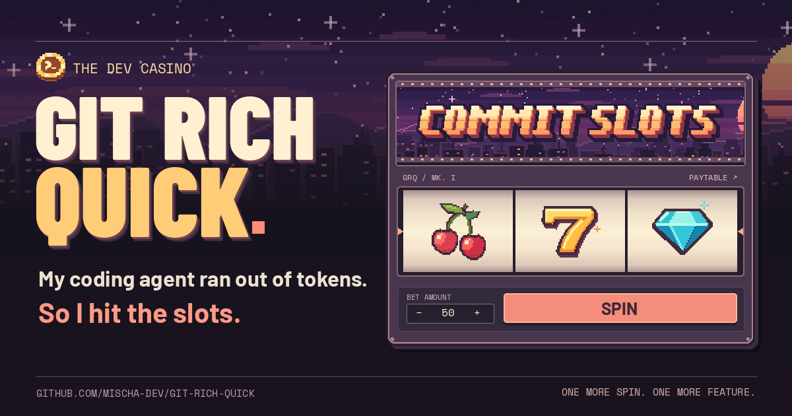

# Git Rich Quick



Your coding agent bills by the step. Your branch needs one more commit. Finance sent you to a casino.

## Play

**[Play Git Rich Quick in your browser](https://mischa-dev.github.io/GIT-RICH-QUICK/)**

Run `npm start` and open **http://127.0.0.1:4173**. Node 22.13 or newer is enough. You start with 1,200 fake tokens. The game saves in your browser and serves its own art, pixel fonts and synth audio.

Press start. Then try not to blink.

### Controls

| Key | Does |
| --- | --- |
| `Space` | Spin Commit Slots |
| `1` | Agent Desk. While VIBE-1 codes, **mash any key** to make it code faster |
| `2` `3` `4` | Merge Conflict, Blame Roulette, Deploy or Die |
| `5` `6` | Token Pond, Sponsor TV |
| `L` | Ledger |
| `Esc` | Back to the floor |

### The dopamine loop

- **Hype meter.** Every spin, catch, keystroke and merge heats the room. Five tiers from COLD to TRANSCENDENT multiply your wins by up to ×2. The synthwave floor speeds up, the music opens up, and at the top tier the stars go to warp. Stop playing and it cools off.
- **XP and levels.** Everything you burn earns XP. Every level up pays a token bonus and gives you a new rank, from ROOKIE to THE HOUSE.
- **Progressive jackpot.** Every slot wager feeds the pool, and it creeps up on its own. Hit 777 and you take all of it.
- **Commit Slots.** Two matching reels hold the third back with a drumroll and a heartbeat. There's AUTO ×10, near-miss teasing, and win tiers from NICE to JACKPOT with slam banners and coins that fly into your wallet.
- **Agent Desk.** Choose a mission card, then type your brief in *power mode*, where every keystroke throws sparks and builds a combo. Deploy and watch VIBE-1 type out the patch. Mash keys or VIBE HARDER to speed it up (the tokens still burn). Merges can crit for double.
- **Merge Conflict, Blame Roulette, Deploy or Die, the Token Pond and Sponsor TV** all pay out through the same effects engine.
- **Ledger** records every transaction. Print a PNG receipt when someone asks how you financed your code.

Open **Sound & FX** (the speaker button) for music, effects and visual intensity (Chill, Hyped, Feral). If your system asks for reduced motion, the screen shake, particles and backdrop motion turn off.

Direct links skip the title screen: `#desk`, `#slots`, `#pond`, `#ads`, `#merge`, `#roulette`, `#deploy`, `#t3`, `#ledger` and `#receipt`.

## Bring a real T3 thread

**Connect T3** opens an edited brief as a draft in T3 Code. You press Send in T3. To charge your fictional wallet for real reported usage, run `npm run t3` on the machine with your T3 server, open **http://127.0.0.1:7777**, and pair a thread. Every 1,000 new reported model tokens costs one casino token. Your real agent and its real spending limits remain under T3's control. [T3 setup and remote machines](./T3.md)

## Development

The production game uses ES modules and has zero runtime package dependencies. To run the regression suite and build a static distribution:

```sh
npm ci
npm test
npm run build
```

Serve the contents of `dist/` from any static web server. Standalone hosting needs only the files in that directory. Font license notices (Barlow, Space Mono, Silkscreen, Pixelify Sans; all OFL) are in `assets/fonts/`.
